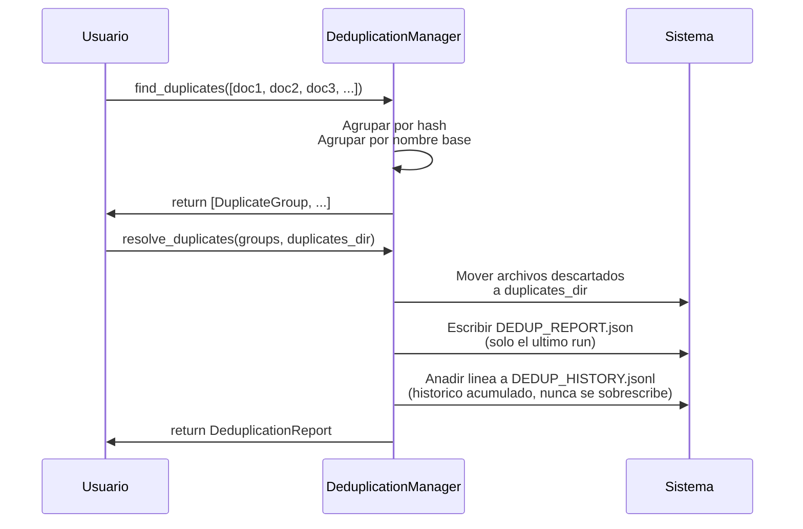

# Deduplicación — Detección y Resolución de Duplicados

Detecta duplicados exactos y conflictos de versión, resuelve moviendo archivos.

## Objetivo

Identificar:
1. **Duplicados exactos**: Mismo SHA-256 (archivo idéntico en dos lugares)
2. **Conflictos de versión**: Mismo nombre base, SHA-256 distinto (versiones diferentes del mismo documento)

Resolver moviendo documentos descartados a carpeta de duplicados.

## Precondiciones

- Documentos escaneados (con SHA-256 calculado)
- Carpeta destino para duplicados debe existir o ser creada

## Flujo Principal

**Paso a paso:**

1. **Análisis**: Agrupa documentos por hash exacto y por nombre base
2. **Selección**: Elige documento canónico (más antiguo) de cada grupo
3. **Resolución**: Mueve no-canónicos a `duplicates_dir`, preservando estructura original
4. **Auditoría**: Escribe `DEDUP_REPORT.json` (solo el último run) y añade una
   línea a `DEDUP_HISTORY.jsonl` (histórico acumulado, consultable en la
   pestaña "Histórico de deduplicaciones" de la página Duplicados)
5. **Retorno**: Reporte con resumen ejecutivo

`resolve_duplicates()` tiene tres llamadores: el botón "Buscar duplicados" de
la pestaña "Buscar duplicados" de la página Duplicados y el subcomando
`deduplicate` (CLI), ambos vía `ScanCommand.deduplicate_streaming()`
(progreso en vivo por grupo — WebSocket `WS /api/projects/{name}/scan/deduplicate`
en la web); y el formulario interactivo de resolución manual de esa misma
pestaña, que llama a `DeduplicationManager` directamente. Internamente,
`resolve_duplicates()` y `deduplicate_streaming()` comparten las mismas dos
primitivas (`DeduplicationManager.move_group()` por grupo,
`DeduplicationManager.finalize_report()` para la persistencia) — solo difieren
en si yieldean progreso entre medias. Los tres alimentan el mismo
`DEDUP_HISTORY.jsonl`. Buscar duplicados es una acción independiente del
escaneo, a petición explícita del usuario, no un paso automático dentro de él.

## Reglas de Negocio

| Regla | Descripción |
|---|---|
| **Canónico = antiguo** | Conserva documento más antiguo por `modified_time` |
| **Replica estructura** | Duplicados se mueven a `duplicates_dir/original/path` |
| **Auditable** | `DEDUP_REPORT.json` con timestamps y decisiones |
| **Colisiones de nombres** | Si destino existe, añade sufijo con hash de 8 caracteres |

## Límites y Restricciones

❌ No elimina archivos (solo mueve)  
❌ No verifica espacio en destino  
❌ No sigue symlinks  

## Casos Especiales

- **Grupo único**: Documento conservado (sin mover)
- **Destino existe**: Renombra con sufijo de hash
- **Permiso denegado**: Error capturado en reporte

## Criterios de Aceptación

*Pendiente de validación QA*
