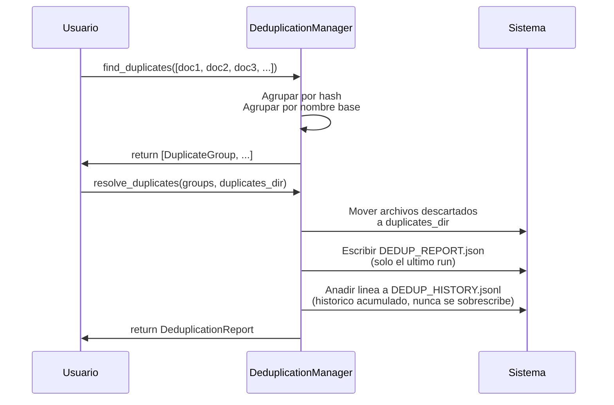

# Deduplicación — Detección y Resolución de Duplicados

## 1. Descripción General

Detecta duplicados exactos, conflictos de versión y, desde 2.2.0, documentos con el mismo contenido o un contenido
parecido; resuelve moviendo (o copiando) los descartados a una carpeta aparte.

### Objetivo

Identificar:
1. **Duplicados exactos**: Mismo SHA-256 (archivo idéntico en dos lugares)
2. **Conflictos de versión**: Mismo nombre base, SHA-256 distinto (versiones diferentes del mismo documento)
3. **Similitud aproximada de nombre** (opcional, `fuzzy_threshold`): nombres de archivo parecidos
   (score RapidFuzz ≥ `fuzzy_threshold`%) entre los documentos que no quedaron ya agrupados por
   las dos pasadas anteriores
4. **Duplicados por contenido** (2.2.0, `ContentDuplicateFinder`, sobre el texto ya convertido): el **mismo
   contenido** en ficheros distintos (p. ej. un `.docx` y el `.pdf` que se generó de él, sin IA) y, opcionalmente,
   **contenido parecido** con la tarea de IA `dedup` (ver [más abajo](#duplicados-por-contenido-220))

Resolver moviendo documentos descartados a carpeta de duplicados (o copiándolos, o solo informando: ver
[Modos de resolución](#modos-de-resolucion)).

### Precondiciones

- Documentos escaneados (con SHA-256 calculado)
- Carpeta destino para duplicados debe existir o ser creada
- Solo para los duplicados por contenido: documentos ya convertidos (su Markdown en `Conversión/`) y, para el
  contenido parecido, un modelo de embeddings propio para la tarea `dedup` (`DOC_ORGANIZE_LITELLM_MODEL_DEDUP`)

## 2. Reglas de Negocio

| Regla | Descripción |
|---|---|
| **Canónico = antiguo** | Conserva documento más antiguo por `modified_time` (propuesta, no aplicada sola, en grupos `fuzzy_name_match`, `same_content` y `semantic_content_match`) |
| **Elección del usuario** | Si el grupo trae `user_choice`, se conserva ese documento en lugar del canónico |
| **Replica estructura** | Duplicados se mueven a `duplicates_dir/original/path` |
| **Auditable** | `DEDUP_REPORT.json` con timestamps y decisiones |
| **Colisiones de nombres** | Si destino existe, añade sufijo con hash de 8 caracteres |
| **Un grupo por documento** | La pasada fuzzy solo opera sobre documentos no agrupados ya por hash exacto o versión |
| **Fuzzy = solo manual** | Los grupos `fuzzy_name_match` nunca se mueven desde "Buscar duplicados" (acción masiva) |
| **Contenido = solo manual (2.2.0)** | Los grupos `same_content` y `semantic_content_match` tampoco: la acción masiva no busca por contenido |
| **Grupos sin cadenas (2.2.0)** | Un documento entra en un grupo por contenido parecido solo si llega al umbral con **todos** sus miembros |
| **Modelo propio para `dedup` (2.2.0)** | El contenido parecido no usa el modelo de `embed`: sin modelo propio para `dedup` falla con `AiConfigurationError` |
| **Texto completo al modelo (2.2.0)** | A la tarea `dedup` va el texto completo de cada documento (con las credenciales redactadas): se recomienda un modelo local |

### Límites y Restricciones

❌ No elimina archivos (mueve, copia o solo informa)  
❌ No verifica espacio en destino  
❌ No sigue symlinks  

## 3. Casos de Uso

### Flujo principal

**Paso a paso:**

1. **Análisis**: Agrupa documentos por hash exacto, por nombre base y, si se indica
   `fuzzy_threshold`, por similitud aproximada de nombre sobre lo que quede sin agrupar
2. **Selección**: Elige documento canónico (más antiguo) de cada grupo — en los grupos por
   similitud aproximada es solo una propuesta, nunca se aplica sin confirmación (ver más abajo)
3. **Resolución**: Mueve no-canónicos a `duplicates_dir`, preservando estructura original
4. **Auditoría**: Escribe `DEDUP_REPORT.json` (solo el último run) y añade una
   línea a `DEDUP_HISTORY.jsonl` (histórico acumulado)
5. **Retorno**: Reporte con resumen ejecutivo

### Similitud aproximada de nombre (`fuzzy_threshold`)

Tercera pasada opcional de `find_duplicates()`, `None` por defecto (retrocompatible). Cuando se
indica un entero 0-100, compara el `display_name` (normalizado: sin extensión, minúsculas,
separadores `_`/`-` unificados a espacio vía `rapidfuzz.utils.default_process`) de los documentos
que no quedaron agrupados por hash exacto ni por conflicto de versión, usando
`rapidfuzz.process.cdist` con `fuzz.WRatio` (vectorizado), y agrupa por componentes conexas del
grafo de similitud (pares con score ≥ `fuzzy_threshold`), con `reason=DuplicateReason.FUZZY_NAME_MATCH`.

**Nunca se resuelven automáticamente**: al ser coincidencias probabilísticas por nombre (no por
contenido), los grupos `FUZZY_NAME_MATCH` quedan excluidos de la deduplicación masiva
(`ScanCommand.deduplicate_streaming()` y el subcomando `deduplicate`, que llaman a
`find_duplicates()` sin `fuzzy_threshold`). Solo deben resolverse tras una confirmación
explícita del usuario, grupo a grupo y eligiendo qué archivo conservar: la librería da las
primitivas (`find_duplicates(fuzzy_threshold=…)`, `move_group()`, `finalize_report()`) y la
confirmación es responsabilidad del consumidor (doc_organize_web la hace con una vista previa
y grupos confirmados).

`ScanCommand.deduplicate_streaming()` (el subcomando `deduplicate` del CLI, con progreso por
grupo) y `DeduplicationManager.resolve_duplicates()` comparten las mismas dos
primitivas (`DeduplicationManager.move_group()` por grupo,
`DeduplicationManager.finalize_report()` para la persistencia) — solo difieren
en si yieldean progreso entre medias. Los tres alimentan el mismo
`DEDUP_HISTORY.jsonl`. Buscar duplicados es una acción independiente del
escaneo, a petición explícita del usuario, no un paso automático dentro de él.

### Modos de resolución

`resolve_duplicates()`, `move_group()` y `deduplicate_streaming()` aceptan `mode`:

| Modo | Qué hace |
|---|---|
| `move` (por defecto) | Mueve los descartados a `duplicates_dir` |
| `copy` | Copia los descartados a `duplicates_dir` sin tocar el origen (apto para orígenes de solo lectura) |
| `report_only` | No toca ningún fichero ni crea `duplicates_dir`: solo cuenta los descartados y escribe el informe |

Desde 2.2.0, con `conversions` (la conversión de cada original) y en modo `move`, el `.md`, el `.json` y las imágenes
del descartado se mueven con él a `duplicates_dir/Conversión/`: deja de entrar en el contexto y se puede devolver a su
sitio sin volver a convertir. En `copy` y `report_only` la conversión no se toca.

### Duplicados por contenido (2.2.0)

`ContentDuplicateFinder.find()` compara lo que **dicen** los documentos (su Markdown ya convertido), no sus metadatos,
en dos pasadas:

1. **Mismo contenido** (`DuplicateReason.SAME_CONTENT`, sin IA): el mismo texto normalizado (sin formato, mayúsculas
   ni puntuación) en ficheros distintos.
2. **Contenido parecido** (`DuplicateReason.SEMANTIC_CONTENT_MATCH`, opcional con `semantic=True`): embeddings por
   bloques de texto con la tarea de IA `dedup`. Detecta también un documento contenido en otro (`contained`). Cada
   grupo trae la similitud semántica (`similarity`) y la de texto (`lexical_similarity`): alta la de texto, es casi el
   mismo texto; baja con la semántica alta, es un texto reescrito o la misma plantilla con otros datos. Una persona
   decide con las dos.

Los duplicados exactos (mismo hash) cuentan una sola vez: esos los agrupa `find_duplicates()`. Los documentos sin
conversión, con el Markdown ilegible o con menos de 30 palabras no se comparan y quedan en
`ContentDuplicateReport.not_compared`.

Como los de nombre parecido, los grupos por contenido **nunca se resuelven solos**: una persona elige qué conservar y
se resuelven con `move_group()`. En modo `copy` el original se queda en su sitio y la siguiente construcción del
contexto lo volvería a incluir; `exclude_from_context()` guarda por cada descartado una decisión `exclude` (solo se
aplica al construir con manifiesto de taxonomía). Guía completa: [Duplicados por contenido](../guides/duplicados_por_contenido.md).

### Flujos alternativos y de error

- **Grupo único**: Documento conservado (sin mover)
- **Destino existe**: Renombra con sufijo de hash
- **Permiso denegado**: Error capturado en reporte
- **Documento demasiado corto o sin conversión** (contenido): no se compara, queda en `not_compared`
- **Fallo al mover la conversión** (modo `move` con `conversions`): su ruta queda como fallida; el original ya se movió

## 4. Criterios de Aceptación

*Pendiente de QA: esta sección se completará cuando el equipo QA valide los criterios.*

## 5. Glosario y Términos

| Término | Definición |
|---|---|
| Duplicado exacto | Mismo SHA-256: archivo idéntico en dos lugares |
| Conflicto de versión | Mismo nombre base, SHA-256 distinto: versiones diferentes del mismo documento |
| Similitud aproximada de nombre | Nombres de archivo parecidos (score ≥ `fuzzy_threshold`%); nunca se resuelve sola |
| Mismo contenido | El mismo texto normalizado (sin formato, mayúsculas ni puntuación) en ficheros distintos |
| Contenido parecido | Similitud por embeddings con la tarea de IA `dedup`; incluye un documento contenido en otro |
| Documento canónico | El que se conserva de cada grupo: el más antiguo, salvo elección del usuario (`user_choice`) |
