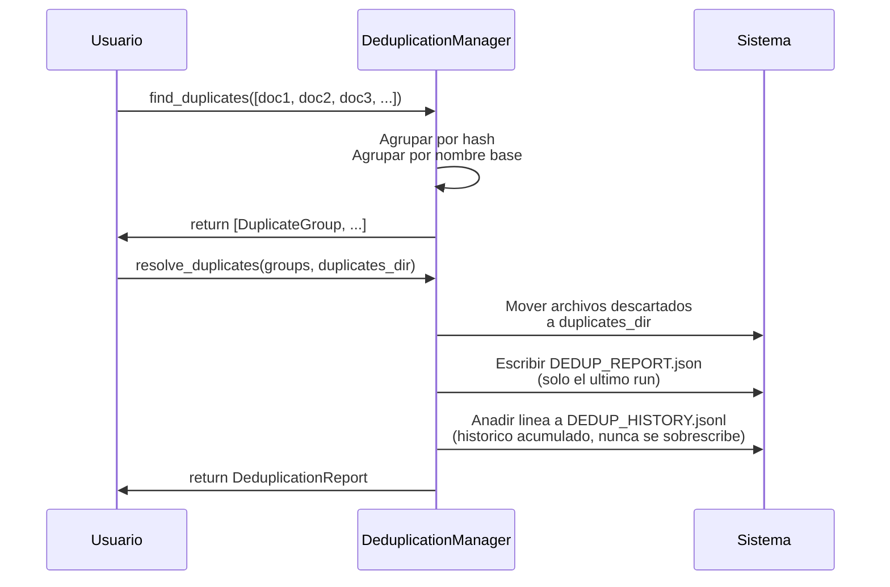

# Deduplicación — Detección y Resolución de Duplicados

Detecta duplicados exactos y conflictos de versión, resuelve moviendo archivos.

## Objetivo

Identificar:
1. **Duplicados exactos**: Mismo SHA-256 (archivo idéntico en dos lugares)
2. **Conflictos de versión**: Mismo nombre base, SHA-256 distinto (versiones diferentes del mismo documento)
3. **Similitud aproximada de nombre** (opcional, `fuzzy_threshold`): nombres de archivo parecidos
   (score RapidFuzz ≥ `fuzzy_threshold`%) entre los documentos que no quedaron ya agrupados por
   las dos pasadas anteriores

Resolver moviendo documentos descartados a carpeta de duplicados.

## Precondiciones

- Documentos escaneados (con SHA-256 calculado)
- Carpeta destino para duplicados debe existir o ser creada

## Flujo Principal

**Paso a paso:**

1. **Análisis**: Agrupa documentos por hash exacto, por nombre base y, si se indica
   `fuzzy_threshold`, por similitud aproximada de nombre sobre lo que quede sin agrupar
2. **Selección**: Elige documento canónico (más antiguo) de cada grupo — en los grupos por
   similitud aproximada es solo una propuesta, nunca se aplica sin confirmación (ver más abajo)
3. **Resolución**: Mueve no-canónicos a `duplicates_dir`, preservando estructura original
4. **Auditoría**: Escribe `DEDUP_REPORT.json` (solo el último run) y añade una
   línea a `DEDUP_HISTORY.jsonl` (histórico acumulado, consultable en la
   pestaña "Histórico de deduplicaciones" de la página Duplicados)
5. **Retorno**: Reporte con resumen ejecutivo

### Similitud aproximada de nombre (`fuzzy_threshold`)

Tercera pasada opcional de `find_duplicates()`, `None` por defecto (retrocompatible). Cuando se
indica un entero 0-100, compara el `display_name` (normalizado: sin extensión, minúsculas,
separadores `_`/`-` unificados a espacio vía `rapidfuzz.utils.default_process`) de los documentos
que no quedaron agrupados por hash exacto ni por conflicto de versión, usando
`rapidfuzz.process.cdist` con `fuzz.WRatio` (vectorizado), y agrupa por componentes conexas del
grafo de similitud (pares con score ≥ `fuzzy_threshold`), con `reason=DuplicateReason.FUZZY_NAME_MATCH`.

**Nunca se resuelven automáticamente**: al ser coincidencias probabilísticas por nombre (no por
contenido), los grupos `FUZZY_NAME_MATCH` quedan excluidos de "Buscar duplicados" (la acción
masiva vía `ScanCommand.deduplicate_streaming()`/WS `/scan/deduplicate`, que sigue llamando a
`find_duplicates()` sin `fuzzy_threshold`). Solo se resuelven desde el formulario interactivo de
la pestaña "Revisar Duplicados" (`POST /api/projects/{name}/duplicates/resolve`), donde el usuario
elige explícitamente qué archivo conservar de cada grupo — el mismo `fuzzy_threshold` usado para
detectarlos debe reenviarse en esa petición, o el re-escaneo propio del endpoint no volverá a
encontrar esos grupos.

Además, cada grupo `FUZZY_NAME_MATCH` lleva su **propia** casilla "incluir este grupo en esta
resolución" en el formulario, **desactivada por defecto**: aunque el usuario envíe el formulario,
un grupo fuzzy no activado explícitamente queda pendiente (no se mueve nada, sigue apareciendo en
el siguiente re-escaneo) — ver `fuzzy_group_toggles` en la referencia técnica. Esta casilla es
independiente de la elección de "qué archivo conservar" (el radio button de cada fila): decide si
el grupo se toca en absoluto, no cuál de sus archivos se conserva.

`resolve_duplicates()` tiene tres llamadores: el botón "Buscar duplicados" de
la pestaña "Buscar duplicados" de la página Duplicados y el subcomando
`deduplicate` (CLI), ambos vía `ScanCommand.deduplicate_streaming()`
(progreso en vivo por grupo — WebSocket `WS /api/projects/{name}/scan/deduplicate`
en la web); y el formulario interactivo de resolución manual de esa misma
pestaña, que llama a `DeduplicationManager` directamente. Internamente,
`resolve_duplicates()` y `deduplicate_streaming()` comparten las mismas dos
primitivas (`DeduplicationManager.move_group()` por grupo,
`DeduplicationManager.finalize_report()` para la persistencia) — solo difieren
en si yieldean progreso entre medias. Los tres alimentan el mismo
`DEDUP_HISTORY.jsonl`. Buscar duplicados es una acción independiente del
escaneo, a petición explícita del usuario, no un paso automático dentro de él.

## Reglas de Negocio

| Regla | Descripción |
|---|---|
| **Canónico = antiguo** | Conserva documento más antiguo por `modified_time` (propuesta, no aplicada sola, en grupos `fuzzy_name_match`) |
| **Replica estructura** | Duplicados se mueven a `duplicates_dir/original/path` |
| **Auditable** | `DEDUP_REPORT.json` con timestamps y decisiones |
| **Colisiones de nombres** | Si destino existe, añade sufijo con hash de 8 caracteres |
| **Un grupo por documento** | La pasada fuzzy solo opera sobre documentos no agrupados ya por hash exacto o versión |
| **Fuzzy = solo manual** | Los grupos `fuzzy_name_match` nunca se mueven desde "Buscar duplicados" (acción masiva) |

## Límites y Restricciones

❌ No elimina archivos (solo mueve)  
❌ No verifica espacio en destino  
❌ No sigue symlinks  

## Casos Especiales

- **Grupo único**: Documento conservado (sin mover)
- **Destino existe**: Renombra con sufijo de hash
- **Permiso denegado**: Error capturado en reporte

## Criterios de Aceptación

*Pendiente de validación QA*
