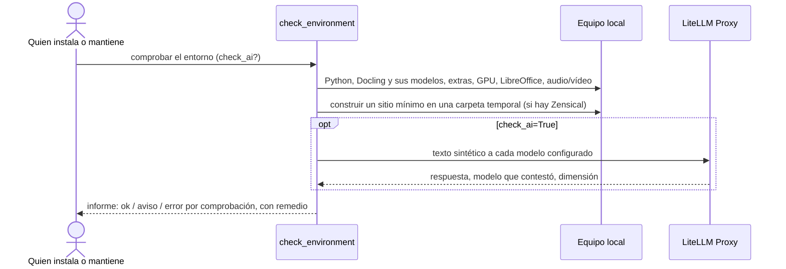

# Diagnóstico del Entorno (2.0)

## 1. Descripción General

Muchos fallos de doc_organize no dependen de los documentos sino del equipo donde se ejecuta: una versión de Python
antigua, los modelos de conversión sin descargar, un complemento opcional sin instalar o un modelo de IA que no
responde. Sin un diagnóstico previo, esos fallos aparecen a mitad de un escaneo o de la construcción del sitio, cuando
ya se ha invertido tiempo.

Desde 2.0.0 la librería ofrece un **diagnóstico del entorno** (`check_environment`) que lo comprueba todo de una vez,
antes de empezar, y devuelve para cada punto si está bien, si hay un aviso o si hay un error, con la forma de
resolverlo. Lo usan quien instala o mantiene la herramienta y cualquier interfaz que quiera mostrar el estado del
sistema.

No toca ningún proyecto ni envía nada de los documentos: la prueba de los modelos de IA usa texto sintético.

## 2. Reglas de Negocio

| Regla | Descripción | Impacto si se viola |
|---|---|---|
| **Sin datos de los documentos** | La prueba de IA envía solo texto sintético | Contenido confidencial saldría hacia el modelo |
| **Sin rutas ni claves en el resultado** | Los detalles del diagnóstico no incluyen rutas ni claves | Se filtrarían secretos al mostrar el informe |
| **Sin red salvo la prueba de IA** | Solo la comprobación de IA (opcional, `check_ai=True`) usa la red | El diagnóstico fallaría o tardaría sin conexión |
| **Error bloquea, aviso informa** | El informe solo se da por bueno (`ok`) si ninguna comprobación da error; un aviso no lo impide | Se daría por válido un entorno que no puede trabajar |
| **Configuración de 1.x detectada** | Si quedan variables de entorno de IA de 1.x, la comprobación de IA da error con la equivalencia de 2.0 | La IA quedaría desactivada sin que nadie lo note |
| **Tareas opcionales solo si están configuradas** | Clasificar, describir y diseñar la taxonomía se prueban siempre que haya IA; agentes, embeddings y duplicados por contenido, solo si tienen modelo propio | Se probarían modelos que no se van a usar |

## 3. Casos de Uso

### Flujo principal

### Flujos alternativos y de error

- **Sin IA configurada**: la comprobación de IA dice que la IA no se usará; no es un error.
- **Modelo de embeddings que corta el texto** (2.2.0): si el modelo de duplicados por contenido no llega a unas
  1.500 palabras, se avisa.
- **Qué modelo contestó** (2.2.0): cada prueba de IA dice el modelo pedido, el que contestó según la respuesta y, en
  los de embeddings, la dimensión del vector.
- **GPU** (2.0.1): con PyTorch sin soporte CUDA (la instalación habitual de Docling), se informa «Sin soporte de GPU en
  este proceso» en lugar de pedir revisar los drivers.
- **Sin sitio de prueba**: con `build_site=False` no se construye el sitio mínimo.

## 4. Criterios de Aceptación

*Pendiente de QA: esta sección se completará cuando el equipo QA valide los criterios.*

## 5. Glosario y Términos

| Término | Definición |
|---|---|
| Comprobación | Cada punto del diagnóstico, con estado `ok`, `warning` o `error`, detalle y remedio |
| Extra | Complemento opcional de la librería que se instala aparte (sitio, exportación a Excel, OCR con GPU…) |
| Texto sintético | Texto inventado para probar un modelo, sin relación con los documentos del usuario |

Referencia técnica: [Diagnóstico](../api/diagnostics.md).
