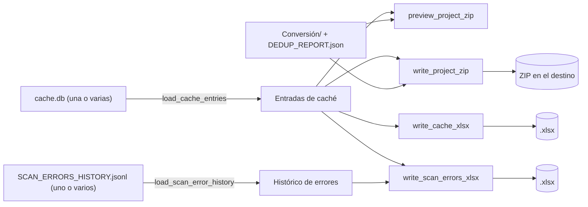

# Exportación — ZIP y Excel de un proyecto

Empaqueta lo que ha producido un proyecto para llevárselo fuera: un ZIP con los documentos convertidos y la
instantánea de la caché, un Excel con todas las entradas de la caché y un Excel con los errores de escaneo.
Disponible como biblioteca (`doc_organize.export`) y como subcomando del CLI (`doc_organize export`).

## Qué contiene cada exportación

| Exportación | Contenido | Requisitos |
|---|---|---|
| ZIP | `Conversión/` completa (Markdown, JSON e imágenes), `cache_export.json` (todas las entradas de caché con su estado: nuevas, modificadas, sin cambios) y `duplicados/DEDUP_REPORT.json` si existe | Ninguno |
| Excel de caché | Hoja `Cache`: archivo, carpeta, ruta, hash SHA-256 completo, estado, conversión y última actualización (UTC), ordenado por ruta | Extra `export` |
| Excel de errores | Hoja `Estado actual` (documentos cuya última conversión falló y si alcanzaron el límite de reintentos) y hoja `Histórico` (un error por fila, agrupado por ejecución de escaneo) | Extra `export` |

El ZIP no incluye logs ni la caché SQLite: es lo que el usuario consulta, no el estado interno.

## Flujo



## Reglas

- **Rutas explícitas.** Las rutas salen de un `ProjectLayout` (raíz de salidas y, si está aparte, raíz del estado) o
  se indican sueltas; nunca del registro de proyectos.
- **Varias cachés.** Un proyecto puede tener una caché por carpeta de origen: se cargan todas y se exportan juntas.
  Una caché que no existe se omite y no se crea.
- **Vista previa exacta.** La vista previa (ficheros y bytes sin comprimir) recorre lo mismo que el ZIP y genera el
  mismo `cache_export.json`; coincide con el ZIP mientras el proyecto no cambie entre las dos operaciones.
- **Streaming.** El ZIP se escribe directamente en el destino, fichero a fichero y por bloques de 1 MiB: sirve para
  proyectos de ~100 000 documentos y ~1 TB sin cargar nada entero en memoria ni crear temporales.
- **Orden estable.** Ficheros en orden alfabético por carpeta, entradas de caché por ruta.
- **Fórmulas neutralizadas.** En el Excel, un texto que empieza por `=`, `+`, `-`, `@`, tabulador o retorno de carro
  se escribe con un `'` delante, para que Excel o LibreOffice no lo ejecuten como fórmula. Se quitan los caracteres de
  control que el formato no admite.
- **Enlaces simbólicos.** No se siguen: un enlace dentro de `Conversión/` no puede meter en el ZIP ficheros de fuera.
- **Progreso y cancelación.** Igual que el escaneo: `on_progress` recibe `ProgressEvent(operation="export")` y un
  `CancelToken` para la exportación entre dos bloques o dos filas. Al cancelar se borra el fichero parcial.

## CLI

```bash
# ¿Cuánto ocuparía? (no escribe nada)
python -m doc_organize export zip --project "Mi Proyecto" --preview

# ZIP de un proyecto del registro del CLI
python -m doc_organize export zip --project "Mi Proyecto" -o export.zip

# Rutas explícitas, con el estado en otro disco y dos cachés
python -m doc_organize export cache-xlsx --output-root /red/Proyecto --state-root /local/estado \
    --cache-file /local/estado/a/cache.db /local/estado/b/cache.db -o cache.xlsx

# Excel de errores (por defecto lee errores_escaneo/SCAN_ERRORS_HISTORY.jsonl del estado)
python -m doc_organize export errors-xlsx --project "Mi Proyecto" -o errores.xlsx
```

| Opción | Uso |
|---|---|
| `--project` | Proyecto del registro del CLI (alternativa a `--output-root`) |
| `--output-root` / `--state-root` | Raíz de salidas y raíz del estado si está aparte |
| `--cache-file` | Una o varias `cache.db` (por defecto la del proyecto) |
| `--errors-log` | Uno o varios históricos de errores (solo `errors-xlsx`) |
| `-o`, `--output` | Fichero a escribir (se sobrescribe) |
| `--preview` | Solo `zip`: muestra ficheros y bytes sin escribir |

## Errores

| Situación | Resultado |
|---|---|
| Falta `openpyxl` al pedir un Excel | `MissingDependencyError` (`pip install doc_organize[export]`) |
| Cancelación | `OperationCancelledError`; el fichero parcial se borra |
| Destino dentro de `Conversión/` | `InvalidPathError` (el ZIP se incluiría a sí mismo) |
| Carpeta de destino inexistente (CLI) | `InvalidPathError` |

Referencia técnica: [API de exportación](../api/export.md).
