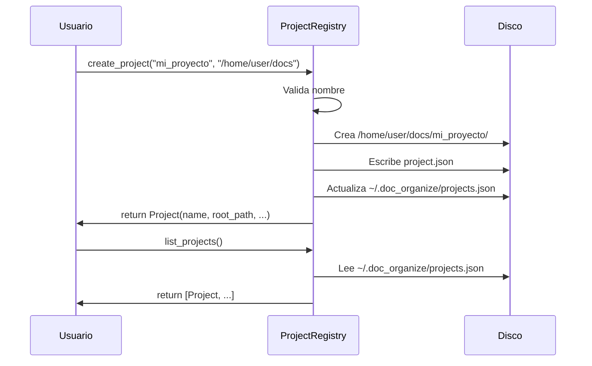

# Projects — Registro y Gestión de Proyectos

Crear, listar y abrir proyectos locales registrados.

## Objetivo

Mantener un registro centralizado (`~/.doc_organize/projects.json`) de proyectos creados por el usuario, cada uno con su propia carpeta y configuración.

## Precondiciones

- Usuario debe tener permisos de escritura en `~/.doc_organize/`
- Nombre de proyecto válido (verificado por `ProjectValidator`)

## Flujo Principal

**Paso a paso:**

1. **Validación**: Normaliza nombre, verifica no existe
2. **Creación**: Crea carpeta + `project.json`
3. **Registro**: Añade entrada a `projects.json` global
4. **Rollback**: Si falla, borra carpeta creada
5. **Listar**: Lee `projects.json` sin verificar existencia física

## Reglas de Negocio

| Regla | Descripción |
|---|---|
| **Nombres únicos** | En todo el registro; comprobación case-insensitive |
| **Registro central** | `~/.doc_organize/projects.json` fuera de proyectos |
| **Creación atómica** | Temp file + `os.replace()` |
| **Locking async** | Poco frecuente (crear proyecto es rara) |

## Límites y Restricciones

❌ No verifica si la carpeta destino existe (asume que la crea)  
❌ No valida que el disco tenga espacio  

## Casos Especiales

- **Carpeta ya existe**: Falla si intenta crear
- **Nombre duplicado**: Lanza `ProjectAlreadyExistsError`
- **Nombre inválido**: Lanza `ProjectNameError`
- **Carpeta no creada**: Rollback automático

## Criterios de Aceptación

*Pendiente de validación QA*

## Lista persistente de carpetas de escaneo

`ScannedFoldersStore` guarda, por proyecto (`<root_path>/scanned_folders.json`),
qué carpetas se han añadido para escanear — distinto del registro central
`projects.json` de arriba.

- **Añadir**: `add_folder(project, path)`; la ruta debe existir y ser una carpeta.
- **Usar**: `mark_used(project, paths)` tras un escaneo correcto; quien escanea o
  deduplica suele procesar todas las carpetas de la lista (`list_folders`).
- **Eliminar**: `remove_folder(project, path)`; solo las carpetas que **nunca** se han usado en un escaneo real
  pueden eliminarse de la lista — una vez usada, queda marcada `used=True` de
  forma permanente, como historial de qué se ha escaneado.

## Gestión destructiva de un proyecto

`ProjectRegistry.delete_project()`, `ProjectRegistry.move_project_root()` y `ProjectHistoryCleaner.clear()` borran,
mueven o vacían un proyecto entero (ver [Projects — API](../api/projects.md)). La confirmación del usuario y el bloqueo
mientras hay un escaneo en curso son responsabilidad del consumidor (doc_organize_web los implementa).

## Descarga de export del proyecto (ZIP)

`write_project_zip()` (subcomando `export zip`) escribe un ZIP con `Conversión/`, `cache_export.json`
y `duplicados/DEDUP_REPORT.json` (si existe). `preview_project_zip()` (`export zip --preview`) estima
antes el tamaño y el número de ficheros sobre el estado actual del proyecto; es informativa: si el
proyecto cambia entre la estimación y la escritura, puede no coincidir. Ver [Exportación](export.md).

## Detección de GPU (entorno, no permisos)

`detect_gpu_status()` detecta si el entorno donde corre doc_organize tiene
soporte de GPU para OCR acelerado (`torch` instalado + `torch.cuda.is_available()`)
y muestra un mensaje con instrucciones si el soporte no está instalado o no está
activo. Es una detección puramente de entorno software — no depende de rol ni
usuario — ver [Resolución de problemas](../guides/troubleshooting.md#ocr-muy-lento-en-documentos-grandes).
