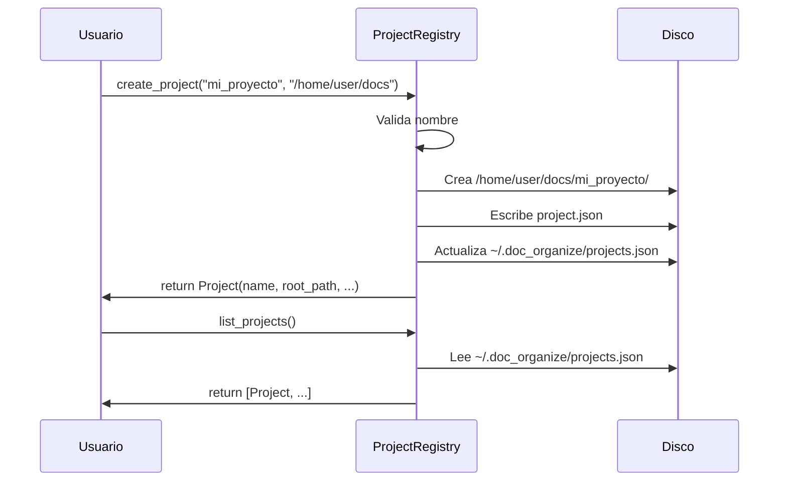

# Projects — Registro y Gestión de Proyectos

Crear, listar y abrir proyectos locales registrados.

## Objetivo

Mantener un registro centralizado (`~/.doc_organize/projects.json`) de proyectos creados por el usuario, cada uno con su propia carpeta y configuración.

## Precondiciones

- Usuario debe tener permisos de escritura en `~/.doc_organize/`
- Nombre de proyecto válido (verificado por `ProjectValidator`)

## Flujo Principal

**Paso a paso:**

1. **Validación**: Normaliza nombre, verifica no existe
2. **Creación**: Crea carpeta + `project.json`
3. **Registro**: Añade entrada a `projects.json` global
4. **Rollback**: Si falla, borra carpeta creada
5. **Listar**: Lee `projects.json` sin verificar existencia física

## Reglas de Negocio

| Regla | Descripción |
|---|---|
| **Nombres únicos** | Por tenant; comprobación case-insensitive |
| **Registro central** | `~/.doc_organize/projects.json` fuera de proyectos |
| **Creación atómica** | Temp file + `os.replace()` |
| **Locking async** | Poco frecuente (crear proyecto es rara) |

## Límites y Restricciones

❌ No verifica si la carpeta destino existe (asume que la crea)  
❌ No valida que el disco tenga espacio  
❌ No previene colisión de rutas entre tenants diferentes  

## Casos Especiales

- **Carpeta ya existe**: Falla si intenta crear
- **Nombre duplicado**: Lanza `ProjectAlreadyExistsError`
- **Nombre inválido**: Lanza `ProjectNameError`
- **Carpeta no creada**: Rollback automático

## Criterios de Aceptación

*Pendiente de validación QA*
