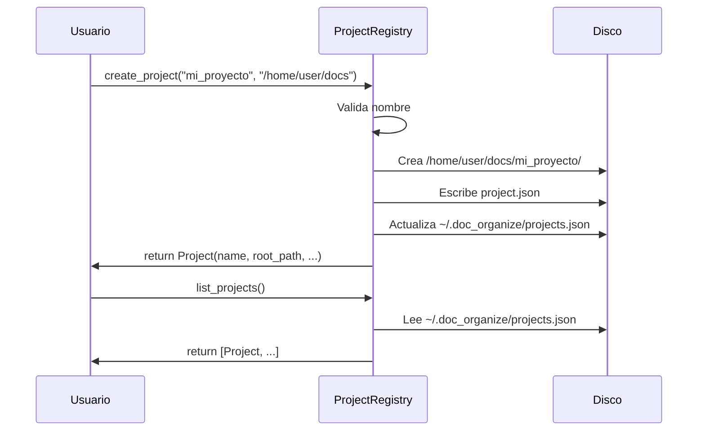

# Projects — Registro y Gestión de Proyectos

Crear, listar y abrir proyectos locales registrados.

## Objetivo

Mantener un registro centralizado (`~/.doc_organize/projects.json`) de proyectos creados por el usuario, cada uno con su propia carpeta y configuración.

## Precondiciones

- Usuario debe tener permisos de escritura en `~/.doc_organize/`
- Nombre de proyecto válido (verificado por `ProjectValidator`)

## Flujo Principal

**Paso a paso:**

1. **Validación**: Normaliza nombre, verifica no existe
2. **Creación**: Crea carpeta + `project.json`
3. **Registro**: Añade entrada a `projects.json` global
4. **Rollback**: Si falla, borra carpeta creada
5. **Listar**: Lee `projects.json` sin verificar existencia física

## Reglas de Negocio

| Regla | Descripción |
|---|---|
| **Nombres únicos** | Por tenant; comprobación case-insensitive |
| **Registro central** | `~/.doc_organize/projects.json` fuera de proyectos |
| **Creación atómica** | Temp file + `os.replace()` |
| **Locking async** | Poco frecuente (crear proyecto es rara) |

## Límites y Restricciones

❌ No verifica si la carpeta destino existe (asume que la crea)  
❌ No valida que el disco tenga espacio  
❌ No previene colisión de rutas entre tenants diferentes  

## Casos Especiales

- **Carpeta ya existe**: Falla si intenta crear
- **Nombre duplicado**: Lanza `ProjectAlreadyExistsError`
- **Nombre inválido**: Lanza `ProjectNameError`
- **Carpeta no creada**: Rollback automático

## Criterios de Aceptación

*Pendiente de validación QA*

## Lista persistente de carpetas de escaneo

`ScannedFoldersStore` guarda, por proyecto (`<root_path>/scanned_folders.json`),
qué carpetas se han añadido para escanear desde la sección "Carpetas guardadas"
del Dashboard del proyecto — distinto del registro central `projects.json` de
arriba.

- **Añadir**: desde la UI, escribiendo la ruta o con el botón "Buscar…" (explorador
  de carpetas del propio servidor, vía `GET /api/fs/browse`).
- **Usar**: tanto "Buscar duplicados" (página Duplicados) como "Escanear" (página
  Escanear) procesan siempre **todas** las carpetas guardadas de la lista — no hay
  selección manual por checkbox; una carpeta añadida después de una ejecución
  previa se incluye automáticamente en la siguiente sin ninguna acción extra.
  "Escanear" solo requiere que exista al menos una carpeta guardada — ya no
  depende de haber ejecutado antes "Buscar duplicados" (ambas acciones viven hoy
  en páginas distintas).
- **Eliminar**: solo las carpetas que **nunca** se han usado en un escaneo real
  pueden eliminarse de la lista — una vez usada, queda marcada `used=True` de
  forma permanente, como historial de qué se ha escaneado.

## Explorador de carpeta padre al crear un proyecto

La página principal de proyectos (`/`) reutiliza el mismo explorador de
carpetas del servidor que "Carpetas guardadas" (botón "Buscar…", vía
`GET /api/fs/browse`) para elegir la ubicación (carpeta padre) del formulario
de creación, en vez de escribir la ruta a mano.

## Gestión destructiva de un proyecto (solo admin)

Cada fila de la lista de proyectos ofrece, únicamente a un rol `admin`, tres
acciones sobre el proyecto completo. Las tres exigen confirmación explícita
del usuario en una ventana modal que muestra primero el **impacto** (nº de
ficheros y tamaño total bajo `root_path`, vía `GET /api/projects/{name}/impact`)
antes de permitir continuar, y las tres se rechazan con `409` si hay un
escaneo o deduplicación en curso para ese proyecto (mismo bloqueo por
`(tenant_id, nombre)` que ya usan `scan_websocket`/`deduplicate_websocket`).

| Acción | Efecto | Endpoint | Reversible |
|---|---|---|---|
| **Vaciar histórico** | Borra TODO el contenido de `root_path` (caché, historial de escaneo/errores/deduplicación, carpetas guardadas, salida de conversión) y regenera `project.json`. El proyecto sigue registrado, vacío. | `POST /api/projects/{name}/clear-history` | No |
| **Eliminar proyecto** | Borra la carpeta de trabajo completa y quita el proyecto del registro. La ventana modal exige escribir el nombre exacto del proyecto para confirmar. | `DELETE /api/projects/{name}` | No — no hay papelera |
| **Mover carpeta raíz** | Mueve `root_path` entero a `<destino>/<nombre>/`, arrastrando todo su contenido (todo vive ya dentro de `root_path`). El destino se elige con el mismo explorador de carpetas del servidor. | `POST /api/projects/{name}/move` | Sí — es solo una reubicación |

Las tres rutas requieren `{"confirm": true}` en el cuerpo de la petición: la
ventana modal del cliente no es la única barrera contra una acción accidental.

## Descarga de export del proyecto (ZIP)

El enlace "Descargar export" del panel lateral (`GET /downloads/projects/{name}/export.zip`)
descarga un ZIP con `Conversión/`, `cache_export.json` y `duplicados/DEDUP_REPORT.json` (si existe).

Antes de descargar, el panel muestra una estimación de tamaño y nº de archivos
(`GET /downloads/projects/{name}/export-preview`), calculada sobre el estado actual del proyecto —
es informativa: si el proyecto cambia entre la carga de la página y la descarga real, puede no
coincidir exactamente.

Si el navegador soporta la File System Access API (`showDirectoryPicker`, disponible en Chrome/Edge
sobre un contexto seguro como `localhost`), el botón abre un selector de carpeta y escribe el ZIP
ahí directamente. En el resto de navegadores (Firefox, Safari) no hay selector: la descarga sigue
el comportamiento estándar del navegador (carpeta de descargas configurada).

## Detección de GPU (entorno, no permisos)

La página de Escaneo detecta, en cada carga, si el entorno del servidor tiene
soporte de GPU para OCR acelerado (`torch` instalado + `torch.cuda.is_available()`)
y muestra un mensaje con instrucciones si el soporte no está instalado o no está
activo. Es una detección puramente de entorno software — no depende de rol ni
usuario — ver [Resolución de problemas](../guides/troubleshooting.md#ocr-muy-lento-en-documentos-grandes).
