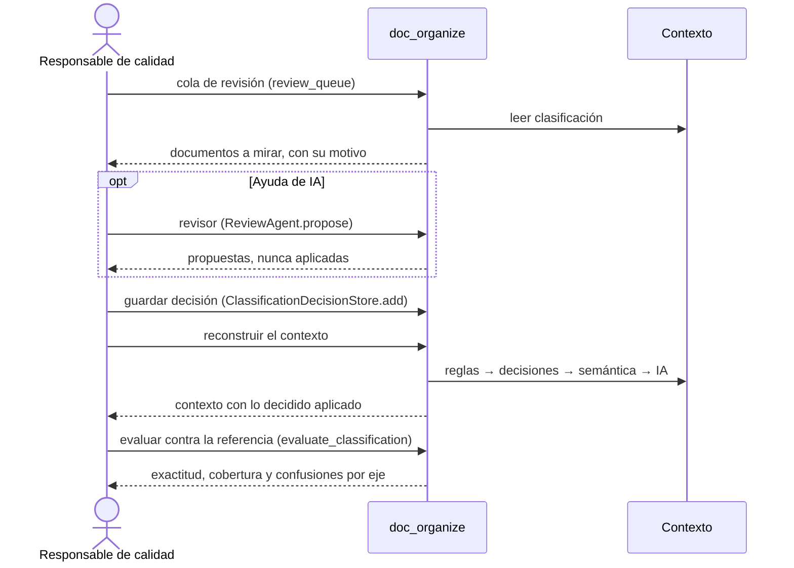

# Revisión y Calidad de la Clasificación (2.0)

## 1. Descripción General

La clasificación automática (reglas, parecido semántico e IA) se equivoca a veces. Desde 2.0.0 la librería da a las
personas responsables de la documentación (responsables de calidad, documentalistas) las piezas para **revisar** lo
clasificado, **corregirlo** de forma duradera y **medir** si un cambio de reglas, de prompt o de modelo mejora el
resultado antes de adoptarlo.

Lo que decide una persona manda: se guarda como una **decisión** y se vuelve a aplicar en cada reconstrucción del
contexto, sin que las reglas ni la IA la cambien. Una **cola de revisión** dice qué documentos conviene mirar y por
qué. Dos **agentes** de IA (diseñador de la taxonomía y revisor) y un **auditor** sin IA ayudan a la persona, pero
**solo proponen**: nunca aplican nada por sí mismos.

Para medir, se compara la clasificación con una **referencia** etiquetada a mano, y se puede construir un contexto
**de prueba**, sin guardarlo, para comparar alternativas. Todo funciona sobre el contexto descrito en
[Organización documental](context.md); las decisiones solo se aplican al construir con manifiesto de taxonomía.

## 2. Reglas de Negocio

| Regla | Descripción | Impacto si se viola |
|---|---|---|
| **Las personas mandan** | Una decisión (`confirm`, `set_axis`, `exclude` o `set_current_version`) se aplica en cada construcción tras las reglas y antes de la semántica y la IA; lo decidido queda como clasificado por una persona | Una reconstrucción desharía el trabajo de revisión |
| **Decisión desfasada, no aplicada** | Si el original cambió desde la decisión (otra huella), o su eje o su valor ya no están en el catálogo, no se aplica y queda para revisarla; si el documento no está en la construcción, queda como huérfana | Se aplicaría una corrección pensada para otro contenido |
| **Una decisión sustituye a la anterior** | Una decisión nueva sobre lo mismo sustituye a la anterior, que pasa al historial como revocada | Decisiones contradictorias sobre el mismo documento |
| **Claves relativas** | Los documentos se identifican por su ruta relativa a la raíz de escaneo, no por la ruta absoluta | Decisiones y referencia dejarían de valer al cambiar de equipo o contenedor |
| **La cola no cambia nada** | La cola de revisión solo lee el contexto y ordena por prioridad; lo ya decidido por una persona no vuelve salvo que su decisión esté desfasada | Revisar dos veces lo mismo |
| **Los agentes solo proponen** | Las propuestas del revisor y del diseñador de la taxonomía nunca se aplican ni se guardan solas: una persona las acepta | La IA cambiaría la clasificación sin control humano |
| **Agentes con topes** | Los agentes paran al llegar a un tope de pasos, tokens o herramientas, o al cancelarse, sin lanzar error | Coste o duración sin límite |
| **Prueba sin efectos** | La clasificación de prueba no guarda el contexto ni el histórico y, por defecto, no usa la caché de IA | Una prueba sustituiría el contexto de trabajo |
| **«Ninguno» es una respuesta** | En la referencia, `ninguno` significa que ningún valor del catálogo encaja y que dejar el eje vacío es lo correcto | La evaluación penalizaría aciertos |

## 3. Casos de Uso

### Flujo principal

Motivos de la cola de revisión: decisión desfasada, sin clasificar, la IA y las reglas no coinciden, cita de la IA
que no aparece en el documento, confianza baja, grupo de versiones cuya vigente no ha confirmado nadie y propuesta
del revisor.

### Flujos alternativos y de error

- **Comparar alternativas antes de adoptarlas** (`dry_run_classify`): se construye un contexto de prueba con otras
  reglas, otro prompt, otro perfil u otro modelo; con una referencia solo se clasifican sus documentos y se devuelve
  su evaluación. Con un contexto de base, dice qué documentos cambian de valor y en qué eje.
- **Referencia a partir de las decisiones** (`gold_from_decisions`) o de un Excel etiquetado (`load_gold_xlsx`, extra
  `export`).
- **Auditar la taxonomía sin IA** (`audit_taxonomy`): estadísticas por eje y propuestas (entradas vacías o dominantes,
  confusiones entre reglas e IA, confianza baja, citas sin verificar, sin clasificar).
- **Comprobar un manifiesto por reglas** (`check_taxonomy_rules`): cobertura, conflictos, entradas vacías y palabras
  clave que no aparecen, sin guardar nada.
- **Diseñar o mejorar la taxonomía** (`TaxonomyDesignAgent`): propone un manifiesto comprobado contra todos los
  documentos y conserva el mejor borrador; la propuesta la revisa una persona.
- **Saber si el contexto está al día** (`check_context_freshness`): qué originales cambiaron, aparecieron o
  desaparecieron desde la última construcción, sin leer los originales.
- **Decisión desfasada u huérfana**: no se aplica; aparece en el contexto y vuelve a la cola de revisión.
- **Agente que llega a un tope o se cancela**: termina con el motivo de parada y lo que tenga hasta entonces.

## 4. Criterios de Aceptación

*Pendiente de QA: esta sección se completará cuando el equipo QA valide los criterios.*

## 5. Glosario y Términos

| Término | Definición |
|---|---|
| Decisión | Corrección o confirmación de una persona sobre la clasificación de un documento, que se vuelve a aplicar en cada construcción |
| Cola de revisión | Lista ordenada de documentos que conviene que mire una persona, con el motivo |
| Referencia | Conjunto de documentos con los valores correctos por eje, etiquetado a mano, para medir la clasificación |
| Clasificación de prueba | Construcción del contexto sin guardarla, para comparar alternativas |
| Agente | Proceso de IA con herramientas y topes que explora los documentos y propone cambios, sin aplicarlos |
| Clave del documento | Ruta del original relativa a la raíz de escaneo, estable entre equipos |

Referencia técnica: [Decisiones](../api/decisions.md), [Evaluación](../api/evaluation.md),
[Agentes](../api/agents.md), [Versiones](../api/versions.md).
