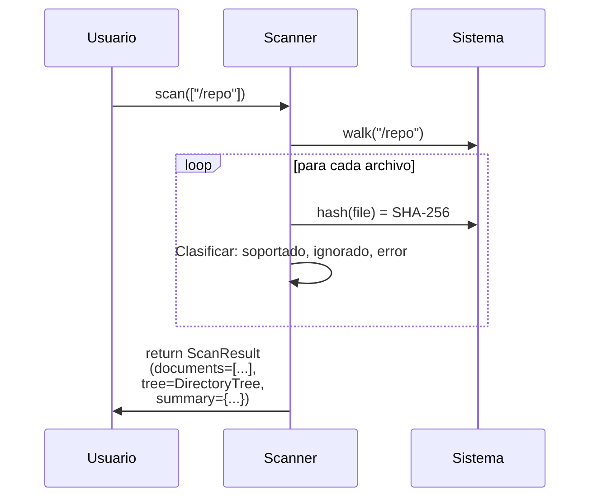

# Scanner — Escaneo Recursivo de Documentos

Descubre documentos en carpetas, calcula SHA-256, genera árbol de directorios.

## Objetivo

Inventariar todos los documentos en una carpeta (respetando extensiones soportadas e ignorando nombres especiales), calcular su identidad criptográfica (SHA-256) y reportar estructura de directorios.

## Precondiciones

- Carpetas válidas (verificadas por `FolderValidator`)
- Permisos de lectura en directorios y archivos
- Extensiones soportadas: las de `SUPPORTED_EXTENSIONS` (PDF, Office, imágenes, HTML, CSV,
  OpenDocument, AsciiDoc, EPUB, correo y texto; ver [Converter](converter.md)); audio y vídeo solo con
  `include_audio_video`

## Flujo Principal

**Paso a paso:**

1. **Descubrimiento**: Recorre directorios recursivamente
2. **Filtrado**: Solo archivos con extensión soportada
3. **Hashing**: Calcula SHA-256 concurrente (async)
4. **Árbol**: Construye estructura jerárquica de directorios
5. **Retorno**: Lista de `DocumentMetadata` + árbol visual

## Reglas de Negocio

| Regla | Descripción |
|---|---|
| **Extensiones soportadas** | Matriz definida en `constants.SUPPORTED_EXTENSIONS` |
| **Ignorar nombres** | `.git/`, `__pycache__/`, `.DS_Store`, más las rutas excluidas y los patrones de nombre que indique el usuario (`exclude_paths`, `ignore_patterns`, 1.3.0) |
| **Hash determinista** | Mismo archivo = mismo SHA-256 siempre |
| **Concurrencia segura** | Hashing paralelo sin bloqueos en archivos |

## Límites y Restricciones

❌ No modifica archivos  
❌ No sigue symlinks ni *junctions* de Windows (se muestran como nodo opaco, sin recorrerlos ni calcular su hash)  
❌ No valida contenido de documentos (escanea solo metadatos)  

## Casos Especiales

- **Archivo en uso**: Se captura pero estado puede ser inconsistente
- **Permisos insuficientes**: Archivo se reporta con error
- **Archivos muy grandes**: Hashing puede ser lento; informar en logs

## Criterios de Aceptación

*Pendiente de validación QA*
