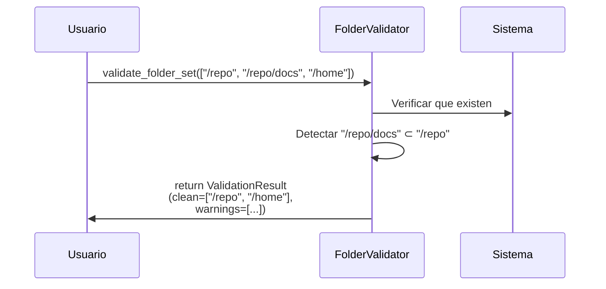

# Validadores de Entrada

Validación previa de carpetas y nombres de proyecto antes de procesarlos.

## Objetivo

Detectar y prevenir datos inválidos **antes** de iniciar el escaneo o crear proyectos, evitando redundancia (carpeta padre + subcarpeta) y errores de nombre.

## Precondiciones

- Las carpetas de entrada deben existir en el sistema de archivos.
- El usuario debe tener permisos de lectura en las carpetas.
- Los nombres de proyecto deben ser strings no vacíos.

## Flujo Principal

**Paso a paso:**

1. **Recepción**: Se recibe lista de rutas (absolutas o relativas)
2. **Resolución**: Expande symlinks, normaliza rutas
3. **Validación**: Comprueba que existen y son directorios
4. **Deduplicación**: Detecta si alguna es subcarpeta de otra
5. **Retorno**: Lista limpias sin redundancia + avisos

## Reglas de Negocio

| Regla | Descripción |
|---|---|
| **Sin redundancia** | Si `/repo` y `/repo/docs` se seleccionan, solo `/repo` |
| **Carpetas existentes** | Todas las rutas deben existir como directorios |
| **Nombres normalizados** | Sin caracteres `<>:"\\/\|?*`, max 255 caracteres |
| **Nombres únicos** | No duplicar nombres dentro de un tenant |

## Límites y Restricciones

❌ No crea ni modifica carpetas  
❌ No sigue symlinks en profundidad  
❌ No valida contenido (eso es responsabilidad del Scanner)  

## Casos Especiales

- **Carpeta no existe**: Lanza `InvalidPathError`
- **Ruta es un archivo**: Lanza `InvalidPathError`
- **Nombres reservados Windows** (CON, PRN, LPT1): Lanza `InvalidNameError`
- **Lista vacía**: Retorna `is_valid=False`

## Criterios de Aceptación

*Pendiente de validación QA*
