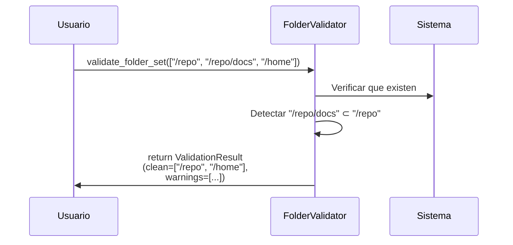

# Validadores de Entrada

## 1. Descripción General

Validación previa de carpetas y nombres de proyecto antes de procesarlos.

### Objetivo

Detectar y prevenir datos inválidos **antes** de iniciar el escaneo o crear proyectos, evitando redundancia (carpeta padre + subcarpeta) y errores de nombre.

### Precondiciones

- Las carpetas de entrada deben existir en el sistema de archivos.
- El usuario debe tener permisos de lectura en las carpetas.
- Los nombres de proyecto deben ser strings no vacíos.

## 2. Reglas de Negocio

| Regla | Descripción | Impacto si se viola |
|---|---|---|
| **Sin redundancia** | Si `/repo` y `/repo/docs` se seleccionan, solo `/repo` | Los documentos de la subcarpeta se procesarían dos veces |
| **Carpetas existentes** | Todas las rutas deben existir como directorios | El error aparecería a mitad de escaneo en lugar de antes de empezar |
| **Nombres normalizados** | Normalizados a NFC; sin caracteres `<>:"\\/\|?*` ni de control, máximo 100 caracteres, sin espacio al principio o al final y sin terminar en punto | El nombre no serviría como carpeta en algún sistema, o un mismo nombre con acentos distintos contaría como dos |
| **Nombres únicos** | No duplicar nombres en el registro de proyectos | Dos proyectos con el mismo nombre serían indistinguibles |

### Límites y Restricciones

❌ No crea ni modifica carpetas  
❌ No sigue symlinks en profundidad  
❌ No valida contenido (eso es responsabilidad del Scanner)  

## 3. Casos de Uso

### Flujo principal

**Paso a paso:**

1. **Recepción**: Se recibe lista de rutas (absolutas o relativas)
2. **Resolución**: Expande symlinks, normaliza rutas
3. **Validación**: Comprueba que existen y son directorios
4. **Deduplicación**: Detecta si alguna es subcarpeta de otra
5. **Retorno**: Lista limpias sin redundancia + avisos

### Flujos alternativos y de error

- **Carpeta no existe**: Lanza `InvalidPathError`
- **Ruta es un archivo**: Lanza `InvalidPathError`
- **Nombres reservados Windows** (CON, PRN, AUX, NUL, COM1-9, LPT1-9): `is_valid=False` con el motivo en `warnings` (no lanza excepción; tampoco el resto de nombres inválidos)
- **Lista vacía**: Retorna `is_valid=False`

## 4. Criterios de Aceptación

*Pendiente de QA: esta sección se completará cuando el equipo QA valide los criterios.*

## 5. Glosario y Términos

*No aplica para este módulo.*
